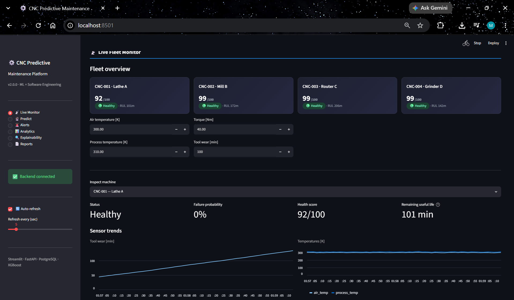
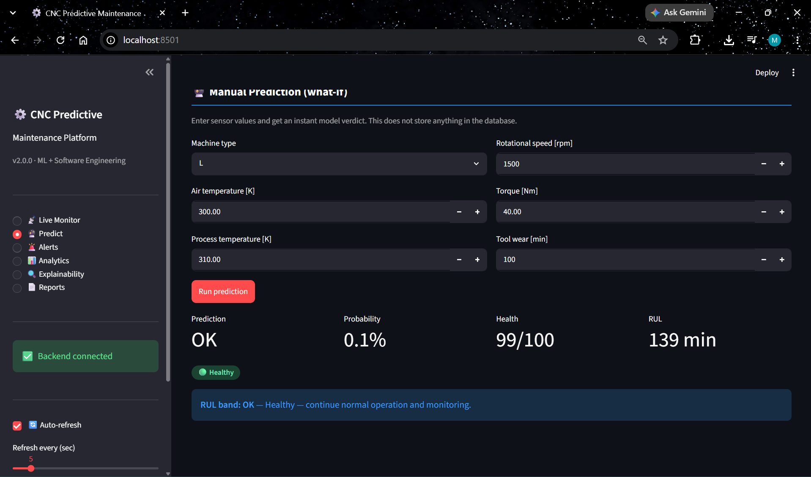
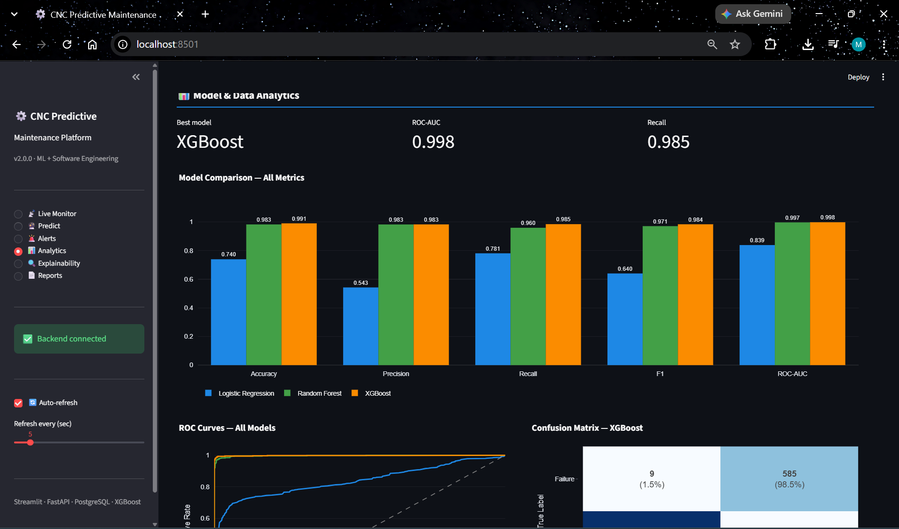
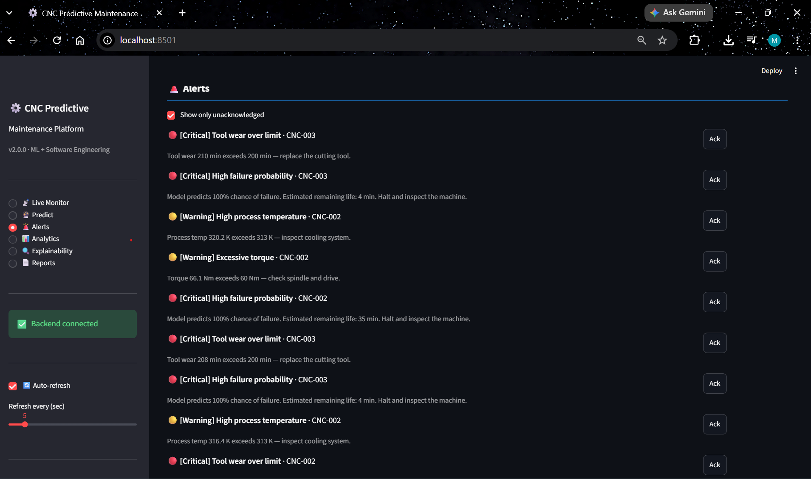
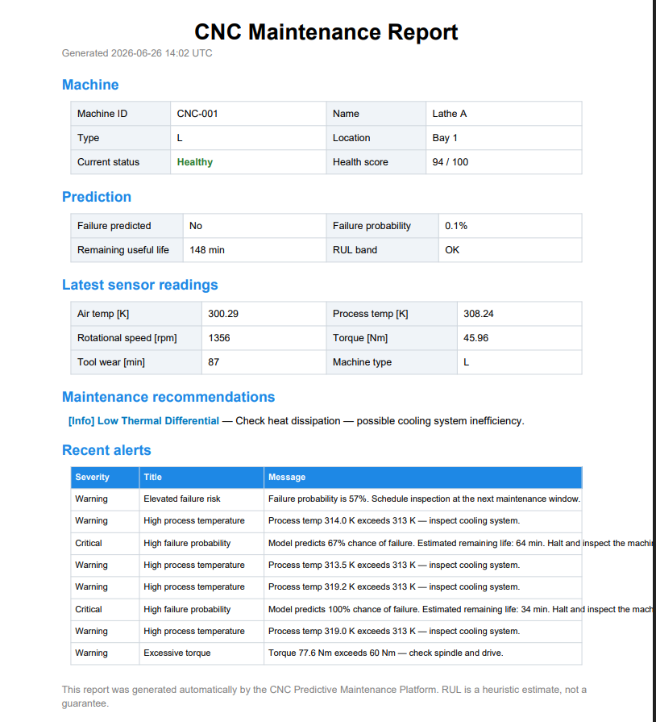
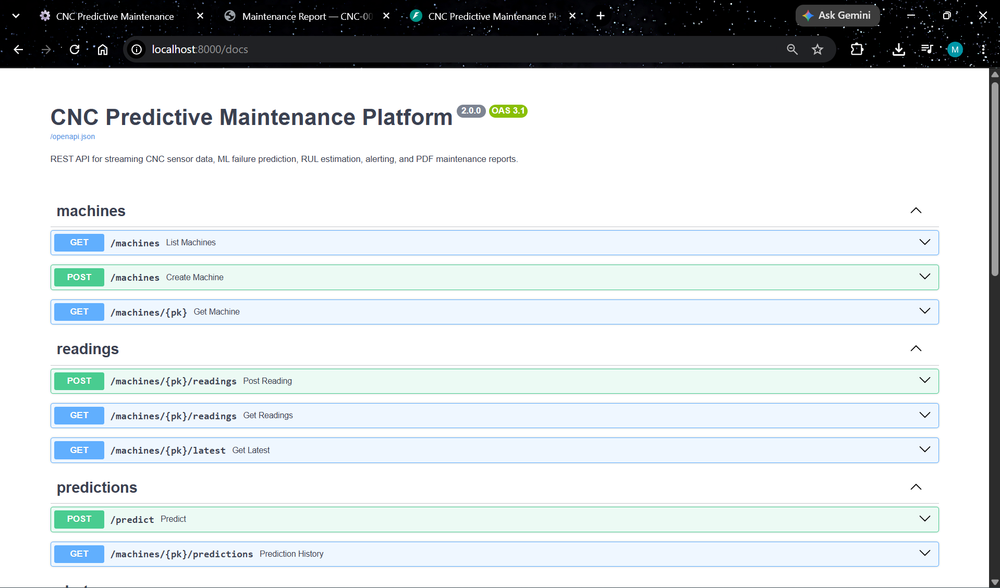
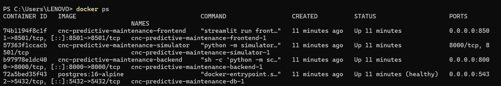

# PredictIQ – Intelligent Predictive Maintenance Platform

A production-style application that predicts failures on CNC machines in real time.
It started as a single Streamlit + scikit-learn project and has been refactored into
a clean, multi-service system: a **FastAPI** backend, a **SQLAlchemy / PostgreSQL**
database, a **live sensor simulator**, an **alerting** engine, **remaining-useful-life
(RUL)** estimation, **PDF reports**, structured **logging**, and an upgraded
**Streamlit** dashboard — all runnable with a single `docker compose up`.

The original machine-learning pipeline (training, prediction, SHAP explainability)
is kept essentially **unchanged**; everything else is new engineering wrapped around it.

---

## Table of contents

1. [What it does](#what-it-does)
2. [Architecture](#architecture)
3. [Project layout](#project-layout)
4. [Quick start (Docker)](#quick-start-docker)
5. [Quick start (local, no Docker)](#quick-start-local-no-docker)
6. [How each piece works](#how-each-piece-works)
7. [REST API reference](#rest-api-reference)
8. [Configuration](#configuration)
9. [The ML pipeline](#the-ml-pipeline)
10. [Interview talking points](#interview-talking-points)

---

## What it does

- Simulates a small fleet of CNC machines streaming realistic sensor data
  (temperatures, rotational speed, torque, tool wear).
- Stores every reading and prediction in a database (full history per machine).
- Runs each reading through a trained ML model to predict failure probability,
  a health score, and a status (Healthy / Warning / Critical).
- Estimates **Remaining Useful Life** with a transparent, explainable heuristic.
- Raises and stores **alerts** when probability or sensor thresholds are crossed.
- Shows it all on a real-time **dashboard** with live charts.
- Generates a downloadable **PDF maintenance report** per machine.


---

# 📸 Project Preview

## 🏠 Live Fleet Monitoring

Real-time dashboard showing machine health, Remaining Useful Life (RUL), live sensor trends, and fleet status.

<p align="center">
  
</p>

---

## 🤖 Manual Failure Prediction

Perform what-if analysis by entering machine sensor values and instantly receiving failure probability, health score, and estimated Remaining Useful Life.

<p align="center">
  
</p>

---

## 📊 Model Analytics

Compare machine learning models using Accuracy, Precision, Recall, F1-Score, ROC-AUC, ROC Curves, and Confusion Matrix.

<p align="center">
  
</p>

---

## 🚨 Alert Management

View active machine alerts with severity levels and maintenance recommendations generated from model predictions and rule-based thresholds.

<p align="center">
  
</p>

---

## 📄 Automated Maintenance Report

Generate downloadable maintenance reports containing machine status, prediction summary, sensor readings, maintenance recommendations, and recent alerts.

<p align="center">
  
</p>

---

## 🔗 REST API Documentation

Interactive FastAPI Swagger documentation for testing and exploring all available endpoints.

<p align="center">
  
</p>

---

## 🐳 Dockerized Deployment

The complete platform runs using Docker Compose with independent services for:

- FastAPI Backend
- PostgreSQL Database
- Streamlit Dashboard
- CNC Sensor Simulator

<p align="center">
  
</p>

---

## Architecture

```
                    ┌──────────────────┐
                    │   Simulator      │  generates realistic sensor readings
                    │ (simulator/)     │  and POSTs them to the API
                    └────────┬─────────┘
                             │ HTTP
                             ▼
┌──────────────┐    ┌──────────────────┐    ┌─────────────────┐
│  Streamlit   │◄──►│  FastAPI backend │◄──►│  Database        │
│  dashboard   │HTTP│  (backend/)      │ORM │  (SQLAlchemy)    │
│ (frontend/)  │    │                  │    │  SQLite/Postgres │
└──────────────┘    └────────┬─────────┘    └─────────────────┘
                             │ calls
                ┌────────────┼────────────┬───────────────┐
                ▼            ▼            ▼               ▼
            ML model     Alerting       RUL          PDF reports
            (ml/)        (utils/)     (ml/rul.py)    (utils/)
```

**One direction of truth:** the simulator and dashboard never touch the database
directly. They go through the backend's REST API. This is the same pattern real
production systems use — the API is the single gatekeeper for all data.

---

## Project layout

```
intelligent-predictive-maintenance/
├── core/                  # Infrastructure config (settings, paths)
│   └── settings.py        # Pydantic settings, loaded from env / .env
│
├── ml/                    # The machine-learning pipeline (mostly original)
│   ├── config.py          # Data-science constants (features, thresholds)
│   ├── preprocess.py      # Dataset loading + scaling/encoding
│   ├── train.py           # Trains LogReg / RandomForest / XGBoost, keeps best
│   ├── predictor.py       # CNCPredictor: load model + predict + health/RUL
│   ├── recommender.py     # Rule-based maintenance recommendations
│   └── rul.py             # NEW: remaining-useful-life heuristic
│
├── database/              # Persistence layer
│   ├── connection.py      # Engine, session, init_db(), get_db() dependency
│   ├── models.py          # ORM tables: Machine, SensorReading, Prediction, Alert
│   └── crud.py            # Create/read helper functions (no raw SQL)
│
├── backend/               # FastAPI application
│   ├── main.py            # App factory, CORS, startup, router registration
│   ├── schemas.py         # Pydantic request/response models
│   ├── deps.py            # Shared dependencies (DB session, predictor)
│   └── routers/           # One file per resource
│       ├── machines.py    #   /machines
│       ├── readings.py    #   /machines/{id}/readings   (the ingest pipeline)
│       ├── predictions.py #   /predict, /machines/{id}/predictions
│       ├── alerts.py      #   /alerts
│       └── reports.py     #   /machines/{id}/report  (PDF)
│
├── simulator/             # Live sensor-data generator
│   └── simulator.py       # Streams realistic readings into the API
│
├── frontend/              # Streamlit dashboard
│   ├── dashboard.py       # Multi-page UI with real-time charts
│   ├── api_client.py      # Thin HTTP client for the backend
│   └── visualization.py   # Plotly/SHAP charts (from original project)
│
├── utils/                 # Cross-cutting helpers
│   ├── logger.py          # Rotating-file + console logging
│   ├── alerting.py        # Turns predictions into alert objects
│   └── pdf_report.py      # Builds the PDF maintenance report
│
├── scripts/
│   └── init_db.py         # Creates tables + seeds default machines
│
├── data/                  # Dataset + local SQLite db live here
├── models/                # Trained model artifacts (.pkl, meta json)
├── logs/                  # Rotating log files
│
├── requirements.txt
├── Dockerfile             # One image, used for all three services
├── docker-compose.yml     # db + backend + frontend + simulator
└── .env.example           # Copy to .env to customize
```

---

## Quick start (Docker)

The fastest way to see everything running together. Requires Docker Desktop.

```bash
docker compose up --build
```

This starts PostgreSQL, seeds the database, launches the API, the dashboard, and
the simulator. Once the logs settle, open:

- **Dashboard:** http://localhost:8501
- **API docs (Swagger UI):** http://localhost:8000/docs

Stop everything with `Ctrl-C`, and `docker compose down` to remove containers
(add `-v` to also wipe the database volume).

---

## Quick start (local, no Docker)

Good for development and debugging. Uses SQLite, so there's no database to install.

```bash
# 1. Install dependencies (a virtual environment is recommended)
python -m venv .venv && source .venv/bin/activate     # Windows: .venv\Scripts\activate
pip install -r requirements.txt

# 2. Train the model (creates models/best_model.pkl etc.)
python -m ml.train

# 3. Create the database and seed the default machines
python -m scripts.init_db

# 4. Start the backend API  (terminal 1)
uvicorn backend.main:app --reload

# 5. Start the simulator    (terminal 2)
python -m simulator.simulator

# 6. Start the dashboard     (terminal 3)
streamlit run frontend/dashboard.py
```

Then open http://localhost:8501 for the dashboard and http://localhost:8000/docs
for the API.

> **Tip:** steps 4–6 each run in their own terminal because they're long-lived
> processes. The simulator and dashboard both read `API_BASE_URL` (default
> `http://localhost:8000`) to find the backend.

---

## How each piece works

**Settings (`core/settings.py`).** One typed settings object, populated from
environment variables or a `.env` file. Anything configurable — database URL,
ports, simulator speed, log level — lives here, so the same code runs unchanged
on a laptop (SQLite) or in Docker (PostgreSQL).

**Database (`database/`).** `models.py` defines four tables as SQLAlchemy ORM
classes with proper relationships and cascade deletes. `crud.py` holds small,
named functions (`create_reading`, `get_latest_prediction`, …) so the rest of
the app never writes raw SQL. `connection.py` builds the engine and exposes
`get_db()`, the dependency FastAPI injects into each request.

**Backend (`backend/`).** A standard FastAPI app split by resource. The heart of
it is the **ingest pipeline** in `readings.py`: when a reading arrives it (1)
stores the reading, (2) runs the model, (3) stores the prediction, (4) evaluates
and stores any alerts, and (5) updates the machine's status — all in one request.

**Simulator (`simulator/`).** A small loop that holds per-machine state (tool
wear slowly climbs, occasional "degradation episodes", maintenance resets) and
posts realistic readings sampled from the AI4I dataset's distributions. It waits
for the backend to be healthy before starting, so startup order doesn't matter.

**Frontend (`frontend/`).** A multi-page Streamlit dashboard. Live pages pull
from the backend through `api_client.py`; the offline Analytics/Explainability
pages load the model and dataset directly (exactly as the original did). Charts
auto-refresh on a configurable interval.

**Utilities (`utils/`).** `logger.py` gives every module a consistent logger with
console output and a rotating file. `alerting.py` converts a prediction into
zero or more alert dicts based on probability bands and sensor thresholds.
`pdf_report.py` builds a clean PDF report with ReportLab.

---

## REST API reference

Interactive docs are always available at `/docs` once the backend is running.

| Method | Path | Description |
|--------|------|-------------|
| `GET`  | `/` | Service info / liveness |
| `GET`  | `/health` | Health check |
| `POST` | `/machines` | Register a new machine |
| `GET`  | `/machines` | List all machines |
| `GET`  | `/machines/{id}` | Get one machine |
| `POST` | `/machines/{id}/readings` | Ingest a reading (runs the full pipeline) |
| `GET`  | `/machines/{id}/readings` | Reading history for a machine |
| `GET`  | `/machines/{id}/latest` | Latest reading + prediction |
| `POST` | `/predict` | Stateless what-if prediction (no DB write) |
| `GET`  | `/machines/{id}/predictions` | Prediction history |
| `GET`  | `/alerts` | All alerts (optionally unacknowledged) |
| `GET`  | `/machines/{id}/alerts` | Alerts for one machine |
| `POST` | `/alerts/{alert_id}/ack` | Acknowledge an alert |
| `GET`  | `/machines/{id}/report` | Download a PDF maintenance report |

---

## Configuration

All configuration is environment-driven. Copy `.env.example` to `.env` and edit
as needed; any value you omit falls back to the default in `core/settings.py`.

| Variable | Default | Purpose |
|----------|---------|---------|
| `DATABASE_URL` | `sqlite:///data/cnc.db` | Database connection string |
| `API_HOST` / `API_PORT` | `0.0.0.0` / `8000` | Where the API binds |
| `API_BASE_URL` | `http://localhost:8000` | How frontend/simulator reach the API |
| `SIM_INTERVAL_SECONDS` | `2.0` | Seconds between simulated readings |
| `SIM_MACHINES` | `4` | Number of machines to simulate (1–4 seeded) |
| `LOG_LEVEL` | `INFO` | Logging verbosity |

---

## The ML pipeline

The model is trained on the **AI4I 2020 Predictive Maintenance** dataset
(included as `data/ai4i2020.csv`; a synthetic fallback is generated if it's
missing, so the project always runs offline).

`python -m ml.train` trains three models — Logistic Regression, Random Forest,
and XGBoost — evaluates them by ROC-AUC, and saves the **best** one along with
its scaler, encoder, and a metadata JSON. At inference time `CNCPredictor` loads
those artifacts and returns, for each reading: a failure prediction, failure
probability, a 0–100 health score, a status, and an RUL estimate.

> **Note on data leakage / feature names:** model fitting and prediction pass
> NumPy arrays at the model boundary (XGBoost 3.x rejects the bracketed AI4I
> column names like `Air temperature [K]`). Column order is fixed by
> `FEATURE_COLUMNS`, so this is safe.

**RUL is a heuristic, not a trained model — and that's intentional.** The AI4I
dataset has no run-to-failure timelines, so there's nothing to train an RUL
regressor on. Instead `ml/rul.py` combines the remaining tool-wear budget with a
stress factor derived from failure probability and health score, and returns a
band (OK / Plan soon / Urgent) plus a plain-English explanation. It's honest,
transparent, and easy to defend in an interview.

---